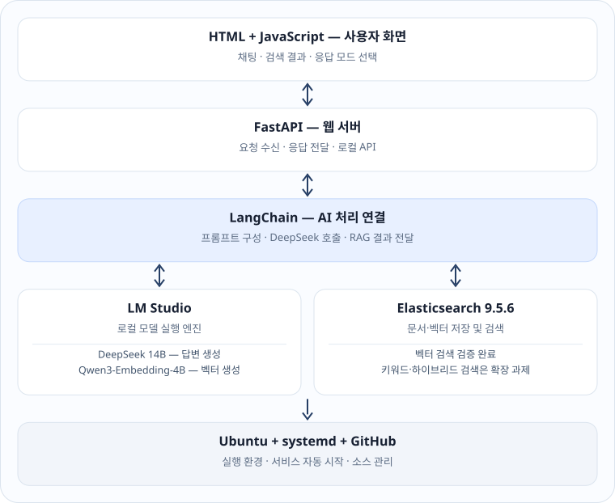
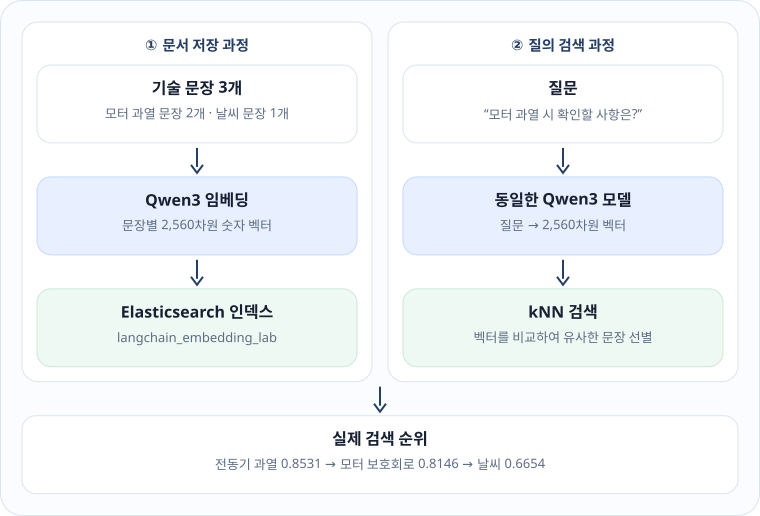
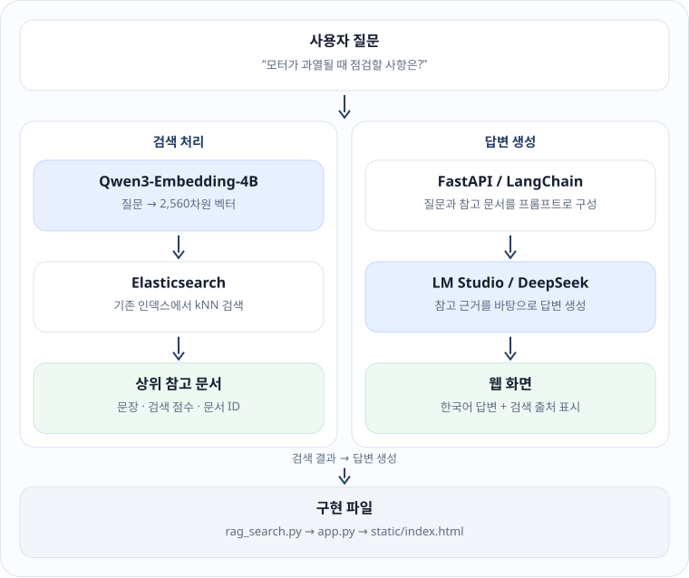
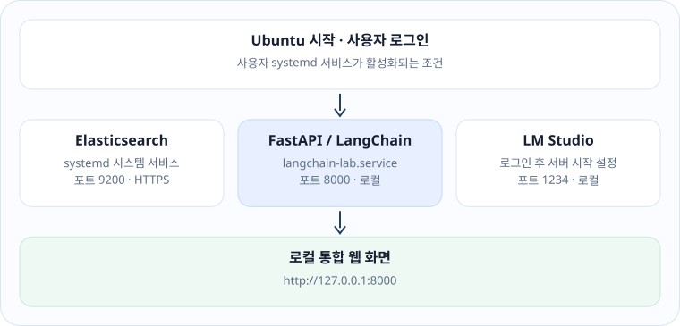
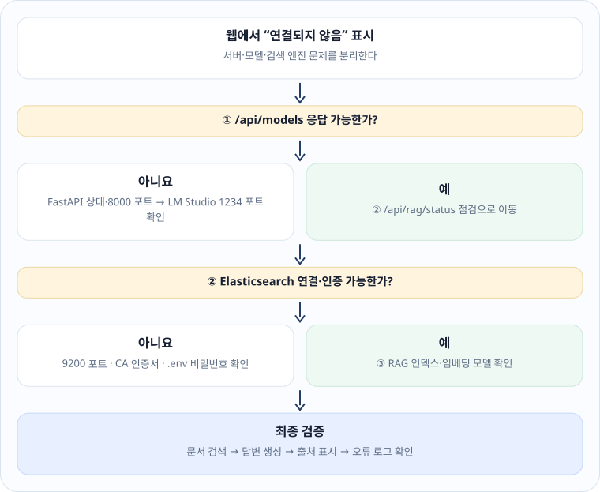

## 배경 개념

**RAG**(Retrieval-Augmented Generation, 검색 증강 생성)는 언어 모델이 모든 지식을 기억하게 만드는 대신, 질문과 관련된 문서를 먼저 검색하고 그 문서를 근거로 답변을 생성하는 구조입니다. 모델 실행, 문장 벡터화, 문서 검색, 웹 통신은 서로 다른 프로그램이 맡습니다.

| 구성 요소 | 하는 일 | 하지 않는 일 |
|---|---|---|
| LM Studio | 언어 모델·임베딩 모델을 메모리에 올리고 OpenAI 호환 API(`127.0.0.1:1234`)로 제공 | 문서 검색 데이터베이스 역할 |
| LangChain | 프롬프트, 모델 호출, 검색 결과를 하나의 처리 흐름으로 연결 | 모델 자체를 실행·학습 |
| Elasticsearch 9 | 문서와 2,560차원 벡터 저장, 키워드·벡터 검색 | 자연어 답변 생성 |
| FastAPI | 브라우저 요청을 받아 Python 처리 코드를 실행하고 HTML 제공 | 검색 품질 보장 |
| GitHub | 소스코드·교재 버전 관리, GitHub Pages로 교재 공개 | 로컬 모델 서버 실행 |

사용 모델은 모두 로컬에서 실행됩니다.

| 모델 ID | 역할 |
|---|---|
| `deepseek-r1-distill-qwen-14b` | 질문에 대한 자연어 답변 생성 |
| `text-embedding-qwen3-embedding-4b` | 문장 → 2,560차원 벡터 |
| `qwen3-vl-4b` | 페이지 이미지 이해 (제3장) |



운영 계층(Ubuntu·systemd·GitHub)은 위쪽 구성요소를 관리하는 기반이지, RAG 데이터가 아래 방향으로 순차 처리되는 별도 단계가 아닙니다.

## 전체 실습 흐름

각 단계의 출력이 다음 단계의 입력입니다. 앞 단계 결과를 직접 확인한 뒤 다음으로 넘어갑니다.

```text
① LM Studio 모델 확인      deepseek · qwen3-embedding · qwen3-vl
        ↓
② LangChain 연결           ChatOpenAI.invoke() 로 로컬 모델 호출
        ↓
③ Elasticsearch 보안 연결  HTTPS + CA 인증서 + 계정 비밀번호
        ↓
④ 문장 임베딩              문장 1개 → 실수 2,560개
        ↓
⑤ 벡터 인덱스 저장·검색    kNN 으로 의미가 가까운 문장 정렬
        ↓
⑥ FastAPI 웹 서비스        일반 채팅 / RAG 모드, systemd 자동 실행
        ↓
⑦ GitHub 배포              로컬 실행 게이트 + 표준 교재 HTML
```

①~⑥은 이 장에서 다룹니다. ⑦ 공개 페이지·실행 버튼·업데이트 운영은 제5장, 모델·주소 설정 분리는 제4장, 업로드 문서의 검색 품질 평가와 개선은 제6장에서 다룹니다.

## 실행 환경과 프로젝트 구성

GitHub 저장소 `Yuul-Jung/langchain-lab`을 `~/langchain_web`에 복제해 사용합니다.

```bash
# 프로젝트 폴더로 이동하고 가상환경 활성화
cd ~/langchain_web
source .venv/bin/activate

# GitHub 최신 코드 반영 (로컬 수정이 있으면 병합하지 않고 멈춤)
git pull --ff-only origin main

# 필요한 Python 패키지 설치
python -m pip install -r requirements.txt
```

확인 기준:

```text
- 프롬프트 앞에 (.venv) 표시
- git pull: 최신 변경 반영 또는 Already up to date
- pip: 의존성 충돌 없이 설치 완료
```

```text
langchain_web/
├── app.py                        # FastAPI: 채팅 API + HTML 제공
├── settings.py                   # 제4장: 주소·모델·인덱스 설정 (.env)
├── llm_providers.py              # 제4장: 로컬 / 대형 LLM API 선택
├── local_status.py               # 제5장: 공개 페이지용 상태 요약
├── rag_search.py                 # Elasticsearch 읽기 검색
├── chat_search.py                # 제6장: 채팅 RAG 검색 대상 선택
├── document_pipeline.py          # 제2장: 문서 구조화·색인
├── document_api.py               # 제2장: 문서 관리 API
├── vlm_ocr.py                    # 제3장: VLM 요청·OCR 대조
├── test_langchain.py             # LangChain 연결 확인
├── test_embedding.py             # Qwen3 벡터 생성 확인
├── test_elasticsearch_vector.py  # kNN 검색 실습
├── static/                       # 로컬 웹 화면 (채팅, 문서 관리)
├── scripts/                      # 시작·업데이트·진단 스크립트
├── tests/                        # 오프라인 단위 테스트
├── education/                    # 이 교재의 원고와 생성기
└── requirements.txt
```

`.env`, `uploads/`, `data/`는 `.gitignore`에 등록되어 GitHub에 올라가지 않습니다.

## LM Studio 모델 목록 확인

```bash
# LM Studio 로컬 서버가 제공하는 모델 ID 목록
curl -s http://127.0.0.1:1234/v1/models | python3 -m json.tool
```

실측 출력 (2026-11-12, 주요 필드만):

```json
{
  "data": [
    {"id": "qwen3-vl-4b"},
    {"id": "text-embedding-qwen3-embedding-4b"},
    {"id": "deepseek-r1-distill-qwen-14b"},
    {"id": "text-embedding-nomic-embed-text-v1.5"}
  ]
}
```

**코드 풀이** — 생성 모델(`deepseek-…`, `qwen3-vl-4b`)과 임베딩 모델(`text-embedding-…`)을 정확히 구분합니다. 임베딩 모델 ID를 채팅 요청에 넣으면 대화 응답을 받을 수 없습니다. 목록에 나타나는 것과 실제로 응답하는 것은 별개이므로, 다음 절들에서 모델별로 호출을 검증합니다.

## LangChain으로 DeepSeek 호출

**파일** `test_langchain.py` · 원본 · 실측 통과 (2026-11-09)

```python
"""Verify LangChain connection to an LM Studio model."""

import requests
from langchain_openai import ChatOpenAI

url = "http://127.0.0.1:1234/v1"
models = requests.get(f"{url}/models", timeout=10).json()["data"]
if not models:
    raise RuntimeError("LM Studio에서 사용 가능한 모델을 찾지 못했습니다.")
model_id = models[0]["id"]

print("사용 모델:", model_id)
llm = ChatOpenAI(
    model=model_id,
    base_url=url,
    api_key="lm-studio",
    temperature=0,
    use_responses_api=False,
)
response = llm.invoke([
    ("system", "모든 최종 답변은 한국어로 작성하세요."),
    ("human", "LangChain이 무엇인지 간단하게 설명해줘."),
])
print(response.content)
```

실측 요약:

```text
LangChain은 언어 모델을 활용한 애플리케이션을 만드는 프레임워크입니다.
문서 분석, 대화 및 데이터 처리 흐름 연결 등에 사용할 수 있습니다.
```

**코드 풀이**

- `base_url` — LangChain은 모델을 직접 실행하지 않고 LM Studio의 OpenAI 호환 API를 호출합니다.
- `models[0]["id"]` — 목록의 첫 번째 모델을 사용합니다. 여러 모델이 올라가 있으면 의도한 모델인지 출력으로 확인합니다.
- `temperature=0` — 출력의 무작위성을 낮출 뿐 사실 정확도를 보장하지 않습니다.
- `use_responses_api=False` — LM Studio가 지원하는 `/chat/completions` 형식으로 호출합니다.

후속 시험에서 DeepSeek-R1-Distill-Qwen-14B가 중국어·영어를 섞거나 날짜를 추측한 사례가 있었습니다. 유창함과 사실 정확성은 따로 평가합니다.

## Elasticsearch 서버 시작과 인증

```bash
# 시스템 서비스 시작과 부팅 시 자동 시작 등록 (관리자 권한)
sudo systemctl start elasticsearch
sudo systemctl enable elasticsearch
systemctl is-active elasticsearch

# HTTPS + CA 인증서 + elastic 계정으로 서버 정보 조회
curl --cacert ~/.config/elasticsearch/http_ca.crt \
  -u elastic https://localhost:9200
```

실측 출력 (주요 필드 발췌, 호스트명·클러스터 ID 제외):

```text
active
{
  "cluster_name": "elasticsearch",
  "version": {"number": "9.5.6"},
  "tagline": "You Know, for Search"
}
```

**코드 풀이** — 처음에는 인증서를 읽지 못해 `curl: (77)` 오류가 났고, 인증서를 사용자 폴더(`~/.config/elasticsearch/`)로 복사한 뒤에는 `401` 비밀번호 오류를 따로 해결했습니다. 두 관문(인증서 검증, 계정 검증)을 모두 통과해야 검색 요청이 가능합니다.

```text
Python / curl ──HTTPS :9200──▶ CA 인증서 검증 ──▶ 계정 비밀번호 검증 ──▶ 검색 요청
```

실무 서비스에서는 관리자 `elastic` 계정을 상시 사용하지 않고 최소 권한 API 키를 씁니다. 비밀번호는 `.env`(권한 600)에만 두고 GitHub에 올리지 않습니다.

## Qwen3 임베딩: 문장을 숫자로

**파일** `test_embedding.py` · 원본 · 실측 통과

```python
"""Test Qwen3 embedding generation through the local LM Studio API."""

import requests

BASE_URL = "http://127.0.0.1:1234/v1"
MODEL_ID = "text-embedding-qwen3-embedding-4b"

def main():
    # Request one vector for a Korean engineering sentence.
    response = requests.post(
        f"{BASE_URL}/embeddings",
        json={"model": MODEL_ID, "input": "전동기 과열 방지 시스템"},
        timeout=120,
    )
    response.raise_for_status()
    data = response.json()
    vector = data["data"][0]["embedding"]
    print("모델:", MODEL_ID)
    print("임베딩 생성 성공")
    print("벡터 차원:", len(vector))
    print("벡터 일부:", vector[:5])

if __name__ == "__main__":
    main()
```

실측 출력:

```text
모델: text-embedding-qwen3-embedding-4b
임베딩 생성 성공
벡터 차원: 2560
벡터 일부: [-0.00018037761037703604, 0.029143691062927246, -0.02527211233973503, -0.033204201608896255, -0.0012401206186041236]
```

**코드 풀이** — 한국어 문장 하나가 실수 2,560개의 배열로 바뀝니다. 이 차원 수는 Elasticsearch 인덱스의 `dims`와 반드시 같아야 합니다. 단어가 달라도 뜻이 비슷한 문장은 벡터 공간에서 가깝게 놓이지만, 그 근접성이 전기적 사양이나 핀 번호의 정확성을 증명하지는 않습니다.

## 벡터 인덱스와 kNN 검색

**파일** `test_elasticsearch_vector.py` · 원본 발췌 · 실측 통과 (문장 3개 소규모 검증)

```python
INDEX = "langchain_embedding_lab"
DOCUMENTS = [
    ("motor_hot", "전동기가 과열되면 온도 센서와 냉각팬을 점검한다."),
    ("motor_temp", "모터 온도가 높아질 때 보호 회로가 동작한다."),
    ("weather", "오늘 날씨는 맑고 바람이 약하다."),
]
QUERY = "모터 과열 시 확인할 사항은?"

# Protect any pre-existing index with this name.
if es.indices.exists(index=INDEX):
    mapping = es.indices.get_mapping(index=INDEX)
    props = mapping[INDEX]["mappings"]["properties"]
    field = props.get("embedding", {})
    if field.get("type") != "dense_vector" or field.get("dims") != dimension:
        raise SystemExit("기존 실습 인덱스 매핑이 다릅니다. 변경하지 않고 종료합니다.")

result = es.search(
    index=INDEX,
    size=3,
    knn={
        "field": "embedding",
        "query_vector": query_vector,
        "k": 3,
        "num_candidates": 10,
    },
    source=["text"],
)
```

실측 출력:

```text
질문: 모터 과열 시 확인할 사항은?
1. 점수 0.8531 | 전동기가 과열되면 온도 센서와 냉각팬을 점검한다.
2. 점수 0.8146 | 모터 온도가 높아질 때 보호 회로가 동작한다.
3. 점수 0.6654 | 오늘 날씨는 맑고 바람이 약하다.
```

**코드 풀이**

- "모터"와 "전동기"는 다른 단어지만 의미가 가까워 상위에 놓였습니다. 무관한 날씨 문장은 마지막입니다.
- 같은 이름의 인덱스가 이미 있으면 매핑을 확인하고, 다르면 **변경하지 않고 종료**합니다. 기존 자료를 보호하는 장치입니다.
- `_score` 0.8531은 정답률 85%라는 뜻이 아닙니다. 문서 3개짜리 실험이므로 실제 데이터시트 검색 성능은 별도로 평가해야 합니다.
- 비밀번호는 UTF-8로 Basic 인증 헤더를 직접 만듭니다. 클라이언트의 `basic_auth`가 비ASCII 문자를 처리하지 못해 `UnicodeEncodeError`가 났던 문제의 해결 코드입니다.



그림의 점수는 검증된 검색 점수이며 정답률이나 확률이 아닙니다. 임베딩 모델이 바뀌면 기존 인덱스 벡터도 다시 만들어야 일관성을 유지할 수 있습니다.

## FastAPI 웹 서비스와 RAG 흐름

브라우저의 HTML은 Python을 실행할 수 없으므로 FastAPI가 요청을 받아 LangChain·Elasticsearch 코드를 호출합니다. HTML도 같은 서버(`127.0.0.1:8000`)가 제공하므로 브라우저의 출처(CORS) 제약을 피합니다.

실측 API 목록 (2026-11-10, `/openapi.json`에서 추출):

```text
GET    /                                   Home
GET    /api/models                         Models
GET    /api/rag/status                     Rag Status
POST   /api/chat                           Chat
GET    /documents                          Documents Page
GET    /api/documents                      Documents List
GET    /api/documents/health/status        Indexing Health
GET    /api/documents/{document_id}        Document Detail
POST   /api/documents/upload               Upload Document
POST   /api/documents/search               Search Documents Api
POST   /api/documents/{document_id}/reindex  Reindex Document
POST   /api/documents/{document_id}/review   Review Document
```

RAG 모드의 처리 순서:

```text
사용자 질문
   ↓  Qwen3 임베딩 (2,560차원)
Elasticsearch kNN 검색 ── rag_search.py → [{id, score, text}, …]
   ↓
프롬프트 결합: 시스템 규칙(한국어, 근거 부족 시 인정) + 검색 문장 + 질문
   ↓
DeepSeek 14B 답변 생성
   ↓
답변 + 출처 목록을 화면에 표시
```



문서 검색과 답변 생성을 분리해서 봅니다. 검색 결과가 잘못되면 생성 모델을 바꿔도 근거가 부족할 수 있습니다.

**파일** `rag_search.py` · 원본 발췌 (2026-11-12 제4장 설정 분리 후)

```python
INDEX = settings.ES_RAG_INDEX   # 기본값 langchain_embedding_lab, .env 의 ES_RAG_INDEX 로 변경
```

2026-11-12까지 RAG 채팅은 제1장 실습 인덱스 `langchain_embedding_lab`(문장 3개)만 검색했습니다. 그래서 제2장에서 업로드한 문서에 대해 질문해도 실습 문장이 근거로 나왔습니다. 지금은 기본값으로 업로드 문서 인덱스(`langchain_documents_v1`)를 검색하고, 실습 인덱스는 `.env`의 `CHAT_RAG_SOURCE=lab`으로 고르거나 업로드한 문서가 하나도 없을 때만 씁니다. 원인 조사와 검색 품질 개선 과정은 제6장에서 다룹니다. 실습 인덱스는 여전히 읽기 전용입니다.

## 웹 RAG 종단 간 실측

```text
POST /api/chat  {"mode": "rag", "messages": [{"role": "user", "content": "모터 과열 시 확인할 사항은?"}]}

HTTP 200 · 12.2초 · deepseek-r1-distill-qwen-14b
전동기가 과열될 때 확인할 사항은 다음과 같습니다:
1. 온도 센서: 온도 센서가 정상적으로 작동하고 있는지 점검합니다.
2. 냉각 팬: 냉각 팬이 정상적으로 돌아가고 있는지 확인합니다.
[자료 1]에 따르면 … 또한 [자료 2]에서 모터 온도가 높아질 때 보호 회로가 동작한다고 되어 있으므로 보호 회로의 상태도 확인하는 것이 좋습니다.

sources: motor_hot 0.8531 · motor_temp 0.8146 · weather 0.6654
```

이 실측은 채팅이 실습 인덱스를 검색하던 때(2026-11-12 낮)의 기록입니다. 지금 같은 결과를 보려면 `.env`에 `CHAT_RAG_SOURCE=lab`을 넣고 서비스를 재시작합니다. 업로드 문서를 대상으로 한 실측은 제6장에 있습니다.

**해석** — 검색된 세 문장 중 관련 있는 두 문장만 답변에 쓰고 번호로 인용했으며, 무관한 날씨 문장은 쓰지 않았습니다. 다만 문서 3개짜리 실습 인덱스이므로 실제 기술 문서 검색 품질은 제2장의 단계별 평가로 따로 확인합니다.

## systemd 자동 실행

**파일** `scripts/install-service.sh` · 원본 발췌

```bash
ExecStart=$PYTHON -m uvicorn app:app --host 127.0.0.1 --port 8000
Restart=on-failure
RestartSec=5
```

```bash
# 비밀번호를 .env 에 저장 (최초 1회, 권한 600)
python scripts/configure-elasticsearch.py

# 사용자 서비스 등록 후 시작·확인
bash scripts/install-service.sh
systemctl --user start langchain-lab
systemctl --user status langchain-lab --no-pager
journalctl --user -u langchain-lab -n 40 --no-pager
```

확인 기준:

```text
Active: active (running)
8000 포트에 서버 하나만 LISTEN
로그에 Address already in use 없음
```

**코드 풀이** — `--host 127.0.0.1`로 외부 네트워크에 노출하지 않습니다. 이전에 터미널에서 직접 띄운 `uvicorn`이 있으면 8000 포트가 겹치므로 그 터미널에서 Ctrl+C로 먼저 종료합니다. LM Studio 자동 실행은 별도 설정(LM Studio의 *Run LLM server on login*)입니다.

```text
사용자 로그인 → systemd 사용자 서비스
   ├─ Elasticsearch  :9200 (시스템 서비스)
   ├─ LM Studio      :1234 (앱 설정으로 자동 시작)
   └─ FastAPI        :8000 (langchain-lab.service)
```



systemd 설정 코드와 실행 절차는 작성했지만, 재부팅 뒤 서비스와 모델이 자동으로 복원되는지는 아직 시험하지 않았습니다(미검증).

## 오류 해결: 증상 → 원인 → 조치

| 증상 | 원인 | 조치 |
|---|---|---|
| `Unit not found` | Elasticsearch 서비스 미설치·미등록 | 설치 상태 확인 |
| `curl: (77)` | CA 인증서를 읽을 수 없음 | 사용자 폴더의 읽기 가능한 CA 경로 사용 |
| HTTP 401 | 계정 인증 실패 | 비밀번호 확인, 제2장의 `repair-es-auth.py` |
| `ResolutionImpossible` | Python 패키지 의존성 충돌 | Elasticsearch 9 클라이언트를 직접 사용 |
| `UnicodeEncodeError` | 비ASCII 비밀번호의 Basic 인증 처리 실패 | UTF-8로 인증 헤더 직접 생성 |
| `Address already in use` | 8000 포트 중복 점유 | 수동 `uvicorn` 종료 후 서비스 하나만 실행 |
| `Failed to fetch` | GitHub Pages에서 로컬 API 호출 차단 | 채팅은 FastAPI가 HTML을 함께 제공하는 동일 출처 구조, 상태 확인만 `/api/status` 허용 |
| `502 LM Studio 모델 응답 실패` | 다른 모델이 메모리를 차지해 채팅 모델 로드 실패 | 오류 메시지·상태 확인에 안내된 `lms unload … && lms load …` |
| 영어·중국어 혼용 답변 | 생성 모델 출력 품질 | 한국어 품질 평가·모델 비교 |

진단 순서:

```text
오류 화면·터미널 출력 확보
   ↓
/api/models        FastAPI 와 LM Studio 응답 여부
   ↓
/api/rag/status    CA 인증서 · 비밀번호 · 인덱스
   ↓
검색 문제인가, 생성 문제인가? 분리해서 검증
   ↓
기존 기능을 보존한 채 수정 적용
```



실제로 발생했던 오류는 `curl (77)`, `401`, `ResolutionImpossible`, `UnicodeEncodeError`, 포트 중복, `Failed to fetch`입니다. 공개 페이지에서 상태 확인이 실패할 때의 표는 제5장에 있습니다.

## 검증 결과와 남은 한계

| 항목 | 근거 | 판정 |
|---|---|---|
| LangChain → DeepSeek 호출 | 한국어 답변 반환 | 통과 |
| Qwen3 임베딩 | 2,560차원 벡터 반환 | 통과 |
| Elasticsearch HTTPS 연결 | 9.5.6 서버 정보 반환 | 통과 |
| kNN 벡터 검색 | 문장 3개 순위 반환 | 통과 (소규모) |
| 브라우저 일반 채팅 | 날짜·기술 설명 응답 확인 | 통과 |
| 웹 RAG 종단 간 | `/api/chat` RAG 모드 200 응답, 12.2초, 출처 [자료 1]·[자료 2] 인용 (2026-11-12) | 통과 |
| 채팅 RAG가 업로드 문서 검색 | 실제 질문 3개에서 정답 문서·쪽이 근거 1위, 답변 정확 (2026-11-12 20:33, 제6장) | 통과 |
| 한국어 답변 품질 | 중국어·영어 혼용 사례 | 실패 (개선 필요) |
| 재부팅 후 자동 복구 | 스크립트 작성, 재부팅 시험 기록 없음 | 미검증 |
| 비전·채팅 모델 동시 로드 | qwen3-vl-4b(16384)가 올라간 상태에서 DeepSeek 14B 로드 실패 | 실패 → 상태 확인이 조치 명령 안내 |

공개 페이지 실행 게이트, 기본 세팅, 실행 버튼의 검증 결과는 제5장으로 옮겼습니다.

질문 세 개에서 관련 문장이 앞섰다고 완성된 검색 시스템으로 단정하지 않습니다. 검색 정확도, 출처 일치율, 한국어 응답 품질은 따로 평가합니다.

## 핵심 정리

- LM Studio는 모델 실행 서버, LangChain은 처리 흐름 연결, Elasticsearch는 검색 데이터베이스, FastAPI는 웹 통신을 맡습니다.
- 생성 모델과 임베딩 모델의 ID를 구분하고, 임베딩 차원(2,560)과 인덱스 `dims`를 일치시킵니다.
- 기존 인덱스는 매핑을 확인한 뒤에만 사용하고, 다르면 바꾸지 않고 멈춥니다.
- 공개 GitHub Pages는 교재와 명령 안내만 제공하고, 실제 서비스는 `127.0.0.1`에서만 동작합니다(제5장).
- 다음 장에서는 PDF·DOCX·HTML 문서를 업로드해 구조를 추출하고 전용 인덱스에 등록합니다.
