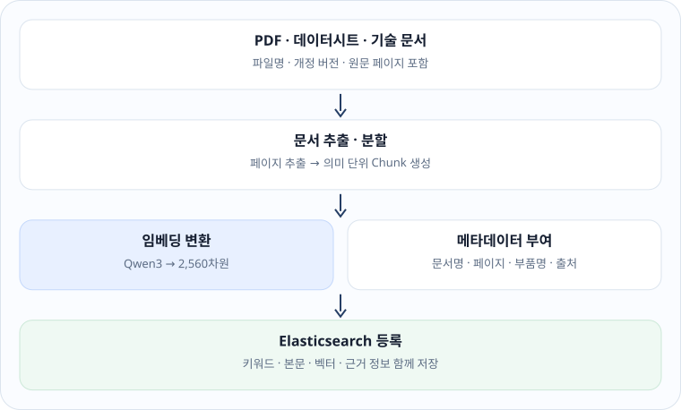

## 배경 개념과 설계 원칙

제1장에서는 문장 3개를 코드에 직접 적어 검색했습니다. 제2장은 실제 자료(PDF·DOCX·HTML·Markdown·TXT)를 웹에서 업로드해 **원본 구조 보존 → 분할·임베딩 → 분류·학습 순서 제안 → 전용 인덱스 등록**까지 처리합니다.

핵심 원칙은 **원본 사실과 AI 추론을 섞지 않는 것**입니다.

| 구분 | 주요 필드 | 기준 |
|---|---|---|
| 원본 | `source_order`, `page`, `title` | 파일에서 추출한 그대로, 임의 재정렬 금지 |
| 분류 | `topic`, `difficulty`, `concepts` | 분석 방식(`llm`/`heuristic`)과 승인 상태 기록 |
| 관계 | `from`, `to`, `type`, `provenance` | 원본 관계(`source_extracted`)와 추론 관계(`rule_inferred`) 구분 |
| 검색 | `text`, `embedding`, `document_id`, `page` | 신규 전용 인덱스 `langchain_documents_v1`에 저장 |

AI가 제안한 분류·학습 순서·관계는 사람이 승인하기 전까지 `review_status: proposed`(검토 대기)입니다. 제1장 실습 인덱스 `langchain_embedding_lab`은 수정하지 않습니다.

## 전체 처리 흐름

```text
① 업로드 원본         PDF · DOCX · HTML · Markdown · TXT  (파일당 30MB)
      ↓
② 구조 추출           장·절·페이지·원본 순서 보존  (최대 600절)
      ↓
③ 텍스트 분할         약 1,150자 단위 · 130자 중첩  (최대 800청크)
      ↓
④ 분류·개념 추론      로컬 DeepSeek JSON 제안, 실패 시 키워드 분류
      ↓
⑤ 관계·학습 순서 제안  precedes · contains · prerequisite · related
      ↓
⑥ 검색 등록           Qwen3 2,560차원 → langchain_documents_v1
      ↓
⑦ 사람 검토           /documents 화면에서 승인
```

| 파일 | 역할 |
|---|---|
| `document_pipeline.py` | 추출, 분할, 분류, 관계·순서 제안, 임베딩·등록, 오류 분류 |
| `document_api.py` | 업로드·목록·상세·검색·재색인·재분석·검토 API |
| `static/documents.html` | 파일 선택, 문서 목록, 구조 보기, 승인 화면 |
| `tests/test_document_pipeline.py` | 외부 서버 없이 도는 단위 테스트 |

한도(파일 크기·절 수·청크 수)는 `.env`의 `UPLOAD_MAX_MB`·`UPLOAD_MAX_SECTIONS`·`UPLOAD_MAX_CHUNKS`로 바꿉니다. 2026-11-12 저녁까지는 8MB·150절·160청크였습니다. 슬라이드형 PDF는 쪽마다 절이 하나씩 생기는데, 183쪽짜리 문서가 절 한도에 걸려 거절되는 것을 확인하고 올렸습니다. 색인은 청크당 약 0.1초가 걸려, 185청크 문서는 AI 분류를 포함해 27.8초였습니다(실측).



이 그림은 업로드 기능을 만들기 전(2026-11-10)에 그린 설계 목표입니다. 실제 구현은 위의 ①~⑦ 흐름이며, "의미 단위 Chunk"는 약 1,150자 경계 분할로, "부품명" 메타데이터는 분류의 `concepts`로 대신했습니다.

## 실습 준비

```bash
# 소스 업데이트 → 패키지 → 구문 검사 → 단위 테스트 → 서비스 재시작 → API 확인
cd ~/langchain_web && git pull --ff-only origin main && bash scripts/update-local.sh
```

확인 기준:

```text
[1/7] GitHub main 브랜치 최신 코드 가져오기
...
[7/7] 실행 상태 및 문서 관리 API 확인
FastAPI /documents 및 /api/documents 정상
등록 문서 수: N
Elasticsearch: 정상
Qwen3 임베딩: 정상
```

검사가 하나라도 실패하면 스크립트는 서버를 재시작하지 않고 멈춥니다. 기존 서비스는 이전 상태로 계속 동작합니다.

## 업로드와 보안 검사

**파일** `document_api.py` · 원본 발췌

```python
@router.post("/upload")
async def upload_document(
    file: UploadFile = File(...),
    use_ai: bool = Form(True),
    index: bool = Form(True),
):
    body = await file.read(MAX_BYTES + 1)
    if len(body) > MAX_BYTES:
        raise HTTPException(status_code=413,
                            detail=f"파일은 최대 {settings.UPLOAD_MAX_MB}MB까지 허용됩니다.")
    ...
```

**코드 풀이**

- 한도보다 1바이트 더 읽어 보고 초과하면 413으로 거절합니다. 파일 전체를 메모리에 올리기 전에 크기를 판단합니다.
- 원본은 사용자 파일명이 아니라 UUID 기반 이름으로 `uploads/documents/`에 저장합니다(Git 추적 제외).
- SHA-256 해시로 같은 파일의 중복 업로드를 찾습니다. **같은 PDF를 다시 올릴 필요가 없습니다.**
- 암호화된 PDF는 거절하고, HTML의 `<script>`는 제거합니다.

업로드 화면은 기본적으로 서버가 실행 중인 PC에서만 쓸 수 있습니다. 다른 기기에서 쓰려면 접속 비밀번호를 설정합니다(제5장 "접근 제어"). 그 밖에 요청 제한, 악성 파일 검사, 문서별 접근 권한은 따로 필요합니다.

## 형식별 원본 구조 추출

| 형식 | 추출 방식 |
|---|---|
| Markdown / HTML | `#`~`######`, `<h1>`~`<h6>` 제목 계층과 본문 순서 |
| DOCX | Word 제목 스타일 |
| PDF | 페이지별 텍스트 + 번호형 제목 후보 |

PDF는 처음에 **페이지 단위**로만 저장해서 장·절 대신 "PDF 1쪽"이 제목으로 나왔습니다. 현재는 줄 단위로 분명한 번호형 제목을 **후보**로 감지합니다.

**파일** `document_pipeline.py` · 원본 발췌

```python
_PDF_HEADING = re.compile(
    r"^(?:[1-9][0-9]?\.(?:\s+(?!\d{1,2}\.)|(?=[가-힣]))[^\n]{2,65}|"
    r"제\s*[1-9][0-9]?\s*[장절]\s*[^\n]{2,65})$"
)
...
candidates, listed = pdf_heading_lines(lines)   # 목차·번호 목록 줄은 제목 후보에서 뺀다
...
has_heading = start in candidates
title = _clean(lines[start]) if has_heading else (
    f"PDF {page_no}쪽 (목차)" if is_toc else f"PDF {page_no}쪽")
item = _new_section(len(sections) + 1, title, fragment, page_no)
if has_heading:
    item["provenance"] = "rule_inferred"
```

**코드 풀이**

- `1. 개요`, `제3장 통신` 같은 줄만 제목 후보로 봅니다. `1.개요`처럼 띄어쓰기가 없어도 마침표 바로 뒤가 한글이면 후보입니다.
- `11. 5.(목) 10:00`처럼 번호 뒤에 다시 `숫자.`가 오는 날짜 줄과 `3.3V` 같은 소수는 후보가 아닙니다.
- 후보 가운데 목차·번호 목록으로 보이는 줄을 먼저 빼고(아래 "목차 페이지와 번호 목록을 제목에서 빼기"), 남은 제목이 한 쪽에 12개를 넘으면 표일 가능성이 커서 제목으로 쓰지 않습니다.
- 감지된 제목은 `provenance: rule_inferred`입니다. **원본 PDF에 검증된 구조 태그가 있다는 뜻이 아닙니다.**
- 텍스트 레이어가 없는 스캔 PDF는 여기서 빈 텍스트가 됩니다. 이 문제는 제3장에서 다룹니다.

## 텍스트 분할과 벡터 처리

**파일** `document_pipeline.py` · 원본

```python
def _split_text(text, max_chars=1150, overlap=130):
    """Deterministic, bounded chunks; overlap is for retrieval context only."""
    result = []
    start = 0
    while start < len(text):
        end = min(start + max_chars, len(text))
        if end < len(text):
            boundary = max(text.rfind("\n", start + max_chars // 2, end),
                           text.rfind(". ", start + max_chars // 2, end))
            if boundary > start:
                end = boundary + 1
        chunk = text[start:end].strip()
        if chunk:
            result.append(chunk)
        if end == len(text):
            break
        start = max(start + 1, end - overlap)
    return result
```

**코드 풀이**

- 최대 1,150자로 자르되, 뒤쪽 절반 안에 줄바꿈이나 `. `가 있으면 그 경계에서 자릅니다. 문장 중간 절단을 줄입니다.
- 다음 청크는 130자 겹쳐 시작합니다. 경계에 걸친 문장의 검색 맥락을 유지하기 위해서입니다.
- `start = max(start + 1, …)`는 어떤 입력에서도 반복이 앞으로 진행하도록 보장합니다.
- 청크마다 `section_id`, `page`, `source_order`를 붙여 검색 결과에서 원본 위치를 찾아갈 수 있게 합니다. 청크가 한도(기본 800개)를 넘으면 파일을 나누라고 거절합니다.

## 자동 분류와 학습 순서 제안

```text
문서 제목 · 대표 문단 (최대 32절)
      ↓
DeepSeek JSON 분류 제안: topic · concepts · difficulty
      ↓
 ┌─ 형식 검증 통과 → method: llm
 └─ 실패·연결 불가 → method: heuristic (키워드 분류)
      ↓
review_status: proposed
```

| 관계 | 의미 | 근거 |
|---|---|---|
| `precedes` | 원문에서 먼저 나타남 | 원본 순서 |
| `contains` | 상위 장이 하위 절을 포함 | 원본 제목 계층 |
| `prerequisite` | 먼저 배워야 할 개념 제안 | 사전 정의 규칙 |
| `related` | 공통 기술 용어가 있음 | 제목 내 공통 용어 |

학습 순서는 `prerequisite` 관계로 **위상 정렬**해 만듭니다. 우선순위가 같으면 원본 순서를 유지하고, 순환 관계가 있으면 원본 순서로 되돌리며 경고합니다. 결과는 `learning_sequence`에 따로 저장하고 `source_order`는 바꾸지 않습니다.

**분석 근거 확인** — 분류의 `method`가 `heuristic`이면 LLM 분석이 성공한 것이 아닙니다. 문서 관리 화면의 **LLM 분류 재분석** 버튼(`POST /api/documents/{id}/reanalyze`)은 새 제안을 다시 `proposed`로 만들며, 이전 `approved` 판정을 자동으로 이어받지 않습니다.

## Elasticsearch 등록과 기존 인덱스 보호

```text
langchain_embedding_lab   제1장 실습 (기존, 읽기 전용)
langchain_documents_v1    제2장 문서 (신규)
   └─ text · embedding(dense_vector 2560) · document_id · chunk_id · page · source_order
```

등록은 문서 ID와 청크 ID를 합친 고유 ID로 합니다. 같은 문서를 재색인해도 중복 문서가 생기지 않습니다. 기존 인덱스 매핑이 다르면 **자동 삭제하지 않고** `INDEX_MAPPING` 오류로 멈춥니다.

등록 중 실패하면 가능한 범위에서 해당 문서의 청크만 정리하고, 카탈로그에 실패 코드·단계를 남겨 나중에 재시도할 수 있게 합니다. 완전한 트랜잭션은 보장하지 않습니다.

## 연결 진단과 실패 복구

업로드 후 상태가 `failed`면 원인을 코드로 확인합니다. 진단 API는 비밀번호를 응답에 넣지 않습니다.

```bash
# Elasticsearch 와 Qwen3 임베딩 연결 진단 (읽기 전용)
curl -s http://127.0.0.1:8000/api/documents/health/status | python3 -m json.tool
```

실측 출력 (2026-11-10):

```json
{
    "elasticsearch": {
        "ok": true,
        "code": "CONNECTED"
    },
    "embedding": {
        "ok": true,
        "code": "READY"
    },
    "document_index": "langchain_documents_v1"
}
```

| 실패 코드 | 의미 | 조치 |
|---|---|---|
| `ES_AUTH` | Elasticsearch가 `.env` 비밀번호를 거부 (401) | `repair-es-auth.py` |
| `ES_CONNECTION` | 9200·HTTPS·인증서 연결 실패 | 서비스·CA 경로 확인 |
| `ES_PERMISSION` | 인덱스 생성·쓰기 권한 없음 (403) | 계정 권한 확인 |
| `INDEX_MAPPING` | 기존 인덱스 매핑 불일치 | 자동 삭제하지 않음, 수동 검토 |
| `LM_CONNECTION` | LM Studio 1234 연결 실패 | `lms server status` |
| `LM_MODEL_NOT_FOUND` | 임베딩 모델 ID 없음 (404) | `/v1/models` 확인 |
| `EMBEDDING_DIMENSION` | 벡터가 2,560차원이 아님 | 임베딩 모델 ID 확인 |

**ES_AUTH 복구** — 서버 비밀번호를 함부로 초기화하거나 문서를 지우지 않습니다. 현재 알고 있는 비밀번호를 입력해 **실제 인증이 성공할 때만** `.env`를 갱신합니다.

```bash
cd ~/langchain_web && git pull --ff-only origin main
.venv/bin/python scripts/repair-es-auth.py     # 비밀번호 입력은 화면에 표시되지 않음
systemctl --user restart langchain-lab
curl -s http://127.0.0.1:8000/api/documents/health/status
```

인증 복구 뒤에도 401이 반복된 원인 중 하나는 실행 중인 프로세스에 남아 있던 예전 `ES_PASSWORD` 환경변수였습니다. `rag_search.py`가 요청 때마다 `.env`를 다시 읽고, 값이 다르면 `.env`를 우선하도록 고쳤습니다.

**단일 문서 재색인 진단** — 연결은 정상인데 `failed`가 남아 있으면, 그것이 과거 기록인지 실제 오류인지 구분합니다.

```bash
# 청크 수가 가장 작은 failed 문서 1개만 재색인하고 결과 코드 출력
cd ~/langchain_web && .venv/bin/python scripts/diagnose-reindex.py
```

다른 문서와 원본 파일은 바꾸지 않습니다.

## 원본 다시 추출과 PDF 띄어쓰기 복원

추출 방식을 고쳐도 **이미 색인된 문서에는 반영되지 않습니다.** "벡터 등록 재시도"는 `failed` 문서만 다시 등록하기 때문입니다. 그래서 저장된 원본에서 처음부터 다시 추출하는 기능을 추가했습니다(2026-11-12).

**문제: 띄어쓰기가 한자로 추출되는 PDF** — 일부 한글 PDF는 띄어쓰기 글자의 문자 변환표(ToUnicode)가 잘못되어, `pypdf`가 공백을 `堺` 같은 엉뚱한 한자 한 글자로 읽습니다. 그대로 색인하면 제목과 본문이 `개발堺환경`처럼 저장되어 검색어와 맞지 않습니다.

**파일** `document_pipeline.py` · 원본 발췌 · 단위 테스트 5개 + 적대적 테스트 8개 통과

```python
def broken_space_glyphs(text, min_count=20, min_ratio=0.6, min_share=0.03):
    """공백이 깨진 것으로 보이는 한자 집합.

    (변경) 진짜 한자('한美동맹', '서울大학교')를 지우지 않도록 조건을 강화했다. 깨진 공백 글자는
    띄어쓰기만큼 자주 나온다(실측: 한글 글자 수의 14.5%, 1,487회). 그래서 min_count 회 이상이고
    한글 글자 수의 min_share 이상일 때만 깨진 공백으로 본다. 정상 문서의 한자는 이 빈도에 못 미친다.
    """
    hangul_total = len(_HANGUL.findall(text))
    counts = defaultdict(int)
    between_hangul = defaultdict(int)
    for i, ch in enumerate(text):
        if not _HAN.match(ch):
            continue
        counts[ch] += 1
        if 0 < i < len(text) - 1 and _HANGUL.match(text[i - 1]) and _HANGUL.match(text[i + 1]):
            between_hangul[ch] += 1
    return {ch for ch, n in counts.items()
            if n >= min_count and between_hangul[ch] / n >= min_ratio
            and n >= hangul_total * min_share}


def repair_broken_spaces(texts):
    """페이지 텍스트 목록에서 깨진 공백 한자를 공백으로 바꾼다. (수정본, 바꾼 글자) 반환."""
    glyphs = broken_space_glyphs("\n".join(texts))
    if not glyphs:
        return list(texts), set()
    table = {ord(ch): " " for ch in glyphs}
    return [t.translate(table) for t in texts], glyphs
```

**코드 풀이**

- 같은 한자가 **20번 이상** 나오고, **한글 글자 수의 3% 이상**이며, 그중 **60% 이상이 한글과 한글 사이**에 끼어 있을 때만 공백이 깨진 것으로 봅니다. 실제 깨진 문서에서 이 글자는 한글 글자 수의 14.5%(1,487회)였습니다.
- 처음 기준은 "5번 이상"뿐이어서 `한美동맹`, `서울大학교`처럼 진짜 한자가 여러 번 나오는 문서의 한자를 공백으로 지웠습니다(원문 훼손). 아래 적대적 검증에서 발견해 기준을 강화했습니다. 그 대가로, 깨진 공백이 20회 미만인 아주 짧은 문서는 복원하지 않습니다.
- `(株)`, `研究`처럼 진짜 한자 표기는 한글 사이에 반복되지 않으므로 바뀌지 않습니다(단위 테스트로 확인).
- 페이지 수와 순서는 그대로 두고 글자만 바꿉니다. `_parse_pdf`가 페이지 텍스트를 읽은 직후 이 함수를 호출합니다.

**원본 다시 추출·재색인** — 문서 관리 화면의 **구조 보기 → 원본 다시 추출·재색인** 버튼, 또는 API로 실행합니다.

```bash
# 문서 하나를 저장된 원본에서 다시 추출하고, 그 문서의 검색 청크만 새로 만든다
curl -s -X POST http://127.0.0.1:8000/api/documents/<document_id>/reextract | python3 -m json.tool
```

응답 형식 (값은 예시):

```json
{
    "document_id": "<document_id>",
    "index_status": "indexed",
    "section_count": 30,
    "chunk_count": 58,
    "previous": {"section_count": 28, "chunk_count": 58, "index_status": "indexed"},
    "approvals": {"same_structure": false, "classification": "kept", "learning_sequence": "reset",
                  "relations_kept": 0, "relations_reset": 0}
}
```

| 단계 | 하는 일 | 실패하면 |
|---|---|---|
| ① 원본 다시 추출 | `uploads/documents/`의 원본으로 절·청크 재생성 | 원본 없음 → 404 |
| ② 카탈로그 갱신 | 절·청크 수, 관계, 학습 순서 갱신 / 유지할 수 있는 승인은 유지, 나머지는 `proposed`로 되돌림 | — |
| ③ 이전 청크 삭제 | 이 문서의 청크만 `document_id`로 삭제 | `delete_old_chunks` 단계 오류 코드 기록 |
| ④ 새 청크 등록 | 임베딩 후 `langchain_documents_v1`에 등록 | `failed` + 오류 코드, 원본 파일은 보존 |

**승인은 어떻게 되는가** — 처음에는 다시 추출하면 분류·학습 순서·관계 승인을 모두 **검토 대기**로 되돌렸습니다. 추출 규칙을 고칠 때마다 승인을 다시 해야 해서, 2026-11-12에 "아직 유효한 승인은 유지"하도록 바꿨습니다. 규칙은 아래 "여러 문서 한 번에 다시 추출" 절에 있습니다. 이전처럼 모두 되돌리려면 주소 뒤에 `?keep_approvals=false`를 붙입니다.

실측 (2026-11-12 17:27, 사용자 PC):

| 대상 | 결과 | 판정 |
|---|---|---|
| 교재 PDF 1개 (띄어쓰기 깨짐) | 다시 추출 6초, 58청크 `indexed` / `堺`가 든 제목 25개 → 0개, 검색 본문에서 `堺` 0건 | 통과 |
| 11월 10일 `failed` 문서 3개 | 벡터 등록 재시도로 3개 모두 `indexed` (3·6·2초), 새 추출 방식이 적용되어 청크 수 증가 (예: 9→34, 38→62) | 통과 |

**주의 — 벡터 등록 재시도의 한계**: "벡터 등록 재시도"는 검색 청크만 새로 만들고 문서 관리 화면의 절 목록·청크 수는 갱신하지 않습니다. 위 재시도 직후 문서 2개는 화면 정보(예: 9청크)와 실제 색인(34청크)이 달랐습니다. 화면과 색인을 맞추려면 "원본 다시 추출"을 씁니다.

### 여러 문서 한 번에 다시 추출

문서가 늘어나면 추출 규칙을 고칠 때마다 문서를 하나씩 눌러 다시 추출하고 다시 승인하는 일이 부담이 됩니다. 그래서 두 가지를 만들었습니다(2026-11-12).

**① 승인 유지 규칙**

| 승인 대상 | 다시 추출한 뒤 | 이유 |
|---|---|---|
| 분류 (주제·난이도·개념) | 유지 | 다시 추출해도 분류 내용은 바뀌지 않습니다. |
| 학습 순서 | 절 구성(쪽·제목·순서)과 순서가 모두 같을 때만 유지 | 절이 달라지면 승인했던 순서가 다른 것을 가리킵니다. |
| 관계 | 같은 종류의 관계가 같은 절 사이에 다시 제안되면 유지 | 절은 ID가 아니라 쪽과 제목으로 비교합니다. |

**파일** `document_pipeline.py` · 원본 · 단위 테스트 8개 통과

```python
def section_signatures(sections):
    """(추가) 절을 (쪽, 제목, 같은 쪽·제목 안에서의 순번)으로 나타낸다.

    절 ID(s0001…)는 재추출하면 다른 절을 가리킬 수 있으므로, 승인을 옮길 때는 ID 대신 이 값을 쓴다.
    """
    seen = defaultdict(int)
    out = {}
    for section in sections:
        key = (section.get("page"), section.get("title"))
        out[section["id"]] = (key[0], key[1], seen[key])
        seen[key] += 1
    return out


def carry_over_approvals(old_meta, sections, classification, relations, sequence):
    """(추가) 재추출 뒤에도 유지할 수 있는 승인을 옮기고, 무엇을 유지·초기화했는지 돌려준다.

    - 분류(주제·난이도·개념): 재추출은 분류 내용을 바꾸지 않으므로 승인을 유지한다.
    - 학습 순서: 절 구성(쪽·제목·순서)과 순서가 모두 이전과 같을 때만 유지한다.
    - 관계: 같은 종류의 관계가 같은 절(쪽·제목) 사이에 다시 제안되면 유지한다.
    classification · relations · sequence 는 새로 만든 값이며 이 함수가 승인 상태를 고쳐 쓴다.
    """
    old_sig = section_signatures(old_meta.get("sections") or [])
    new_sig = section_signatures(sections)
    same_structure = list(old_sig.values()) == list(new_sig.values())
    summary = {"same_structure": same_structure}

    if (old_meta.get("classification") or {}).get("review_status") == "approved":
        classification["review_status"] = "approved"
        summary["classification"] = "kept"
    else:
        summary["classification"] = "not_approved"

    old_sequence = old_meta.get("learning_sequence") or {}
    if old_sequence.get("review_status") == "approved":
        before = [old_sig.get(i) for i in old_sequence.get("section_ids", [])]
        after = [new_sig.get(i) for i in sequence.get("section_ids", [])]
        if same_structure and before == after:
            sequence["review_status"] = "approved"
            summary["learning_sequence"] = "kept"
        else:
            summary["learning_sequence"] = "reset"
    else:
        summary["learning_sequence"] = "not_approved"

    approved = {(r.get("type"), old_sig.get(r.get("from")), old_sig.get(r.get("to")))
                for r in old_meta.get("relations") or [] if r.get("review_status") == "approved"}
    kept = 0
    for relation in relations:
        key = (relation.get("type"), new_sig.get(relation.get("from")), new_sig.get(relation.get("to")))
        if relation.get("review_status") == "proposed" and key in approved:
            relation["review_status"] = "approved"
            kept += 1
    summary["relations_kept"] = kept
    summary["relations_reset"] = len(approved) - kept
    return summary
```

**코드 풀이**

- 절 ID(`s0001`…)는 다시 추출하면 다른 절을 가리킬 수 있습니다. 앞에 절이 하나 생기면 ID가 한 칸씩 밀립니다. ID로 비교하면 엉뚱한 승인을 유지하게 되므로 **(쪽, 제목, 순번)**으로 비교합니다. 이 규칙을 일부러 "ID만 비교"로 바꾸면 테스트 4개가 실패하는 것을 확인했습니다.
- 승인되지 않았던 것을 승인으로 바꾸는 일은 없습니다. 이전에 `approved`였던 것만 옮깁니다.
- 결과에 무엇을 유지하고 무엇을 되돌렸는지 돌려주어, 화면이 그대로 보여 줍니다.

**② 변경 미리보기와 일괄 실행**

```bash
# 읽기 전용: 다시 추출하면 달라지는 문서와, 그때 승인이 어떻게 되는지 계산 (아무것도 바꾸지 않음)
curl -s http://127.0.0.1:8000/api/documents/maintenance/reextract-preview | python3 -m json.tool

# 달라진 문서를 차례로 다시 추출 (원본 파일은 그대로, 문서별 검색 청크만 새로 만듦)
curl -s -X POST http://127.0.0.1:8000/api/documents/maintenance/reextract-batch \
  -H 'Content-Type: application/json' -d '{}' | python3 -m json.tool
```

문서 관리 화면에서는 **07 · 추출 규칙 변경 반영**의 "변경 미리보기" → "달라진 문서 모두 다시 추출" 버튼입니다.

| 장치 | 동작 |
|---|---|
| 비교 기준 | 실제 색인의 청크 본문 지문(SHA-256) → 없으면 카탈로그에 저장한 지문 → 없으면 절 구성·청크 수 |
| 시작 전 확인 | Elasticsearch나 임베딩 모델이 준비되지 않았으면 시작하지 않습니다. |
| 중간 실패 | 색인 오류가 나면 거기서 멈추고 남은 문서는 건드리지 않습니다. 원본 파일이 없는 문서는 건너뜁니다. |

실측 (2026-11-12, 실제 문서 목록·원본·색인의 **임시 복사본**에서 실행하고 삭제):

| 확인 | 결과 | 판정 |
|---|---|---|
| 미리보기 (문서 7개) | 2.3초, 달라진 문서 1개(2 → 4청크). 카탈로그 파일 변화 없음 | 통과 |
| 일괄 재추출 | 승인된 문서의 분류 승인 `approved` 유지, 절 구성이 달라져 학습 순서 승인만 검토 대기. 색인 청크 수 = 문서 목록 청크 수 | 통과 |
| 다시 미리보기 | 달라진 문서 0개 | 통과 |
| 실제 자료 | 문서 목록·원본·색인(185청크) 그대로 | 통과 |
| 실제 서버의 화면 | 미리보기 표 7줄, 달라진 문서 1줄, 일괄 버튼 활성 (화면 없는 Chrome) | 통과 |

**주의** — "달라짐"이라고 해서 다시 추출하는 것이 항상 이득은 아닙니다. 위에서 달라진 문서는 절 단위로 더 잘게 나뉘는데, 다시 추출한 뒤 평가 질문 하나의 정답이 결과에서 빠졌습니다(정답 포함 1.000 → 0.955, 임시 복사본). 잘게 나뉜 조각에 문서 제목 낱말이 없어졌기 때문입니다. 다시 추출한 뒤에는 제6장의 채점 도구로 확인합니다. 실제 문서는 다시 추출하지 않았습니다.

### 목차 페이지와 번호 목록을 제목에서 빼기

재추출 뒤에도 **제목 한 줄뿐인 청크**가 검색 1위로 나왔습니다. 원인을 줄 단위로 보니 두 종류였습니다.

줄 모양 (문구는 설명용 예시):

```text
목차 페이지                       본문의 번호 목록
  Ⅰ. 개요                           2. 실습 목표           ← 진짜 제목 (아래에 본문)
  1. 배경          ← 제목으로 오인   목표는 다음과 같다.
  2. 구성          ← 제목으로 오인   1. 회로를 이해한다.    ← 제목으로 오인
  3. 일정          ← 제목으로 오인   2. 값을 측정한다.      ← 제목으로 오인
  Ⅱ. 실습                           3. 결과를 비교한다.    ← 제목으로 오인
  1. 준비          ← 제목으로 오인   설명 문단 …
```

진짜 제목은 아래에 본문이 있지만, 목차와 번호 목록은 **번호 줄이 본문 없이 연달아** 나옵니다. 이 차이를 규칙으로 만들었습니다(2026-11-12).

**파일** `document_pipeline.py` · 원본 발췌 · 단위 테스트 6개 + 적대적 테스트 19개 통과

```python
def pdf_heading_lines(lines):
    """(추가) 페이지 줄 목록에서 제목으로 쓸 줄 번호와, 목록·목차로 판단한 줄 번호를 돌려준다.

    번호 줄이 본문 없이 2개 이상 연달아 나오면 목차나 번호 목록(예: '1. 구조를 이해한다.')으로 보고
    제목으로 쓰지 않는다. 진짜 제목은 아래에 본문이 있다. 단, 제목 바로 뒤에 '1.'부터 시작하는
    목록이 붙은 경우(예: '2. 목적' → '1. …')에는 앞의 줄만 제목으로 남긴다.
    """
    cleaned = [_clean(line) for line in lines]
    # (변경) 마침표로 끝나는 줄은 문장(목록 항목)이지 제목이 아니다
    candidates = [i for i, line in enumerate(cleaned)
                  if _PDF_HEADING.fullmatch(line) and not line.endswith(".")]
    runs, run = [], []
    for i in candidates:
        if run and all(not cleaned[j] or _PDF_SEPARATOR.fullmatch(cleaned[j])
                       for j in range(run[-1] + 1, i)):
            run.append(i)
        else:
            if run:
                runs.append(run)
            run = [i]
    if run:
        runs.append(run)
    headings, listed = [], set()
    for run in runs:
        if len(run) == 1:
            headings.append(run[0])
            continue
        # (변경) 번호가 둘째 줄에서 다시 1로 시작하면 첫 줄은 제목이다.
        # 첫 줄 번호도 1이면('1. 개요' → '1. …', '2. …') 셋째 줄이 2인지까지 확인한다.
        numbers = [_heading_number(cleaned[i]) for i in run[:3]]
        restarts = numbers[1] == 1 and (numbers[0] != 1 or (len(numbers) > 2 and numbers[2] == 2))
        if restarts:
            headings.append(run[0])
            run = run[1:]
        listed.update(run)
    # Excessive matches usually mean a table or numbered list, not headings.
    if len(headings) > 12:
        headings = []
    return headings, listed
```

**코드 풀이**

- 번호 줄 사이에 빈 줄, 로마 숫자 부 제목(`Ⅱ. …`), 쪽 번호만 있으면 "연달아 나온 것"으로 묶습니다.
- 묶음이 2줄 이상이면 목차·번호 목록으로 보고 제목으로 쓰지 않습니다. 그 줄들은 지우지 않고 본문에 남깁니다.
- `2. 목적` 바로 뒤에 `1.`부터 시작하는 목록이 붙으면, 번호가 다시 1로 시작하므로 앞의 줄만 제목으로 남깁니다. 제목 번호도 1인 경우(`1. 개요` → `1. …`, `2. …`)에는 셋째 줄이 2인지까지 보고 앞줄을 제목으로 남깁니다.
- 마침표로 끝나는 번호 줄(`1. …를 이해한다.`)은 문장이므로 처음부터 후보에서 뺍니다.
- 한 쪽의 절반 이상이 목록 줄이고 5줄 이상이면 그 쪽 제목을 `PDF N쪽 (목차)`로 붙입니다.
- 제목 앞에 찍힌 쪽 번호(`21`)만 있는 조각은 청크로 만들지 않습니다(`is_page_number_only`).

실측 (2026-11-12, 사용자 PC, 재추출 후):

| 문서 | 이전 청크 → 이후 | 60자 미만 청크 | 승인 |
|---|---|---|---|
| 교재 PDF (목차 페이지 있음) | 58 → 36 | 28 → 5 | 검토 대기 (변화 없음) |
| 과제 PDF A (번호 목록 많음) | 9(화면)·34(색인) → 21 | 15 → 2 | 승인 → **검토 대기로 초기화, 다시 승인 필요** |
| 종합과제 PDF | 38(화면)·62(색인) → 63 | 3 → 3 | 검토 대기 (변화 없음) |
| 승인된 PDF 2개 | 새 규칙으로 바뀌는 절이 없어 재추출하지 않음 | — | 승인 유지 |

종합과제 PDF는 한 쪽에 번호 줄이 12개를 넘어 진짜 제목까지 버려지던 쪽에서, 목록 줄이 빠지면서 제목 `1. …` 하나가 되살아나 절이 1개 늘었습니다. 다섯 문서 모두 화면 청크 수와 색인 청크 수가 일치합니다.

검색 확인 (`evaluate-pipeline.py --query`, 본문 길이만 출력):

```text
이전: rank=1 chars=2      ← 쪽 번호만 있는 청크
이후: rank=1 chars=1147   ← 본문 청크
      rank=5 chars=374    ← 목차 페이지 전체가 청크 하나
```

남은 차이 — 승인된 PDF 1개는 11월 10일에 저장된 2청크와 지금 추출 결과(4청크)가 다릅니다. 오늘 규칙 때문이 아니라 그 사이의 추출 방식 개선 때문이며, 재추출하면 승인이 초기화되므로 그대로 두었습니다.

### 추출 적대적 검증

추출 규칙을 "잘 되는 예"로만 확인하면, 규칙을 속이는 입력을 놓칩니다. 그래서 추출을 **깨뜨리려는 입력** 50개를 만들어 검증했습니다(2026-11-12, `tests/test_extraction_adversarial.py`).

| 영역 | 사례 수 | 깨뜨리려 한 것 |
|---|---|---|
| 제목 판별 | 19 | 날짜 줄, 소수 전압, 문장형 번호 줄, 목차, 번호 표, 길이 경계(65자·66자), 전각 공백 |
| 쪽 분할 | 15 | 빈 쪽, 쪽 번호만 있는 쪽, 제어문자, 절 한도 초과, 암호화 PDF, 무작위 쪽 400개의 줄 보존 |
| 깨진 공백 복원 | 8 | 진짜 한자를 깨진 공백으로 오인하게 만드는 문서 |
| 청크 분할 | 8 | 경계가 없거나 애매한 긴 글에서 글자가 빠지는지 |

수정 전 코드에 같은 테스트를 돌리면 8개가 실패했습니다. 테스트가 실제로 그 버그를 잡는지 확인하는 절차입니다.

| 찾은 버그 | 깨뜨린 입력 (지어낸 예) | 고친 방법 |
|---|---|---|
| 진짜 한자를 공백으로 지움 | `한美동맹`이 5회 이상 나오는 문서 | 20회 이상이고 한글 글자 수의 3% 이상일 때만 복원 |
| 날짜 줄이 제목이 됨 | `11. 5.(목) 10:00 모임` | 번호 뒤에 다시 `숫자.`가 오면 제외 |
| 문장형 번호 줄이 제목이 됨 | `1. 이것은 목록의 유일한 항목이다.` | 마침표로 끝나는 줄 제외 |
| 제목이 목록에 묻혀 사라짐 | `1. 개요` 바로 뒤에 `1. …`, `2. …` | 번호가 다시 1, 2로 시작하면 앞줄을 제목으로 유지 |
| 띄어쓰기 없는 제목을 못 봄 | `1.개요` | 마침표 바로 뒤가 한글이면 후보 |
| 제어문자가 본문에 남음 | `data[7␀0]` (␀는 NUL) | 공백으로 바꿈 |

제어문자는 PDF 글꼴이 변환하지 못한 문장부호(`:`, `-`, `[`, `]`) 자리에 들어옵니다. 원래 글자는 텍스트 추출만으로 복구할 수 없어, 보이지 않는 문자가 색인에 남지 않게만 합니다. 실제 저장 문서 두 개에 29개와 4개가 있었습니다.

```python
_CONTROL_CHARS = re.compile("[\x00-\x08\x0b\x0c\x0e-\x1f\x7f]")
```

**쪽 머리 줄 붙이기** — 쪽 맨 위의 제목 한 줄이 아래 본문과 떨어져 혼자 청크가 되면, 내용 없이 검색 1위에 오릅니다(31자짜리 청크가 설명이 있는 쪽들보다 위에 나온 사례). 80자 미만의 머리 줄은 같은 쪽의 바로 아래 절 앞에 붙입니다. 원문 글자와 순서는 그대로입니다.

**파일** `document_pipeline.py` · `_parse_pdf` 원본 발췌

```python
# (추가) 쪽 맨 위의 짧은 머리 줄(쪽 제목 등)은 혼자 청크가 되면 내용 없이 검색 1위에
# 오르므로, 바로 아래 절의 본문 앞에 붙인다. 원문 순서와 글자는 그대로다.
if (pos == 0 and not has_heading and len(starts) > 1
        and len(fragment) < SHORT_LEAD_CHARS):
    lead = fragment
    continue
if lead:
    fragment, lead = lead + "\n" + fragment, ""
```

짧은 청크의 점수를 순위에서 깎는 방법도 먼저 실험했지만 채택하지 않았습니다. 짧은 청크 가운데 정답인 표가 있어, 설정에 따라 정답이 결과에서 빠졌기 때문입니다.

실측 (2026-11-12, 색인을 바꾸지 않는 메모리 검사 후 재추출):

| 확인 | 결과 | 판정 |
|---|---|---|
| 저장된 PDF 5개의 원문 줄 보존 | 사라진 줄 0, 순서 바뀐 줄 0 (뺀 것은 쪽 번호 조각 1개) | 통과 |
| 처음 보는 문서 12개 추출 (PDF 10, HTML 2) | 11개는 줄 손실 0·제어문자 0, 183쪽 PDF는 절 한도 150 초과로 실패 → 한도 상향 후 185청크 색인 | 통과 |
| 재추출 후 제어문자가 든 청크 | 12개 → 0개 | 통과 |
| 재추출 후 청크 수 | 교재 PDF 36 → 35, 과제 PDF A 21 → 20, 종합과제 PDF 63 → 60 | 통과 |
| 검색 지표 (제6장의 평가 세트) | 후퇴 없음. MRR 0.890 → 0.898 | 통과 |

**고치지 않고 기록한 한계** — 이름이 `test_limit_`로 시작하는 테스트 5개가 현재 동작을 그대로 적어 둡니다. 한계를 고치면 그 테스트가 실패하므로 그때 기대값을 바꿉니다.

- 쪽 맨 끝의 제목은 본문이 다음 쪽에 있어도 제목만 있는 절이 됩니다.
- 한 쪽에 제목이 13개 이상이면 표로 보고 전부 제목에서 뺍니다.
- 제목 둘 사이에 쪽 번호만 있으면 목차로 봅니다.
- `2026`처럼 숫자만 있는 4자리 이하 줄은 쪽 번호로 보고 뺍니다.
- 깨진 공백이 20회 미만인 아주 짧은 문서는 복원하지 않습니다.

테스트로 만들지 않은 관찰 사항도 있습니다. 슬라이드형 PDF는 번호 없는 첫 줄이 제목이라 모든 절 제목이 `PDF N쪽`이 됩니다. 검색에는 지장이 없지만 문서 관리 화면의 구조 보기는 쪽 번호 나열이 됩니다.

## 단계별 품질 평가

검색 엔진이나 프레임워크를 추가하기 전에 **PDF 전처리 → 임베딩 → 검색 → 답변 생성**을 단계별로 따로 평가합니다.

```bash
# 1. 문서별 추출 문자 수 · 절 · 청크 · 제목 후보 · 빈 청크 (읽기 전용)
.venv/bin/python scripts/evaluate-pipeline.py

# 2. 실제 임베딩 + Elasticsearch 검색: 결과 개수·점수·페이지·본문 길이만 출력
.venv/bin/python scripts/evaluate-pipeline.py --query "UART 16배 오버샘플링"

# 3. 상위 결과 본문에 키워드가 들어 있는지 확인
.venv/bin/python scripts/evaluate-pipeline.py --query "UART 수신" --expected "UART"
```

**코드 풀이**

- 결과에는 문서 본문·파일명·ID를 출력하지 않습니다. 비공개 자료를 평가 로그로 노출하지 않기 위해서입니다.
- `--expected`는 **키워드 포함 검사**일 뿐 의미 검색의 정확도를 증명하지 않습니다.
- 이 스크립트는 LLM을 호출하지 않습니다. 답변 품질은 근거 문서와 정답이 있는 평가 질문 세트로 따로 봅니다.
- 색인 상태 `indexed`와 높은 유사도 점수만으로 시스템 전체를 합격 처리하지 않습니다.

## 검증 결과와 제한

| 항목 | 근거 | 판정 |
|---|---|---|
| Elasticsearch·임베딩 연결 진단 | `CONNECTED` / `READY` 실측 (2026-11-10) | 통과 |
| 문서 관리 API 등록 | `/openapi.json` 경로 목록 실측 (2026-11-10) | 통과 |
| ES_AUTH 복구 절차 | 복구 후 연결 진단 정상 | 통과 |
| PDF 업로드 후 검색 | 검색 성공, 단 제목이 페이지 단위로만 나옴 | 통과 (구조는 제한) |
| PDF 번호형 제목 후보 | 목차·번호 목록 줄 제외 후 제목만 있는 청크 28→5, 15→2 (2026-11-12). 문서별 제목 정확도 전수 비교는 안 함 | 통과 (부분) |
| 쪽 번호만 있는 청크 제외 | 2글자 청크가 검색 1위 → 제거 후 1위 본문 1,147자 (2026-11-12) | 통과 |
| PDF 띄어쓰기 깨짐(`堺`) 복원 | 교재 PDF 재추출: 깨진 제목 25개 → 0개 (2026-11-12) | 통과 |
| 원본 다시 추출·재색인 | 6초, 58청크 `indexed` (2026-11-12) | 통과 |
| `failed` 문서 재시도 | 3개 모두 `indexed` (2026-11-12) | 통과 |
| 일괄 재추출 + 승인 유지 | 임시 복사본: 문서 7개 미리보기 2.3초, 달라진 1개 재추출, 분류 승인 유지, 실제 자료 그대로 (2026-11-12) | 통과 |
| 추출 적대적 검증 | 사례 50개, 버그 8건 수정, 저장된 PDF 5개 원문 줄 손실 0 (2026-11-12) | 통과 |
| 업로드 한도 30MB·600절·800청크 | 183쪽 슬라이드형 PDF를 실제 업로드 함수로 색인: 185청크, 27.8초 (임시 색인, 2026-11-12) | 통과 |
| LLM 분류 품질 | `heuristic` 폴백 여부 문서별 확인 필요 | 미검증 |
| 오프라인 단위 테스트 | 160개 통과 (2026-11-12 22:38), CI 통과 | 통과 |
| RAG 채팅과 업로드 문서 통합 | 채팅 RAG가 업로드 문서를 검색 (2026-11-12, 제6장) | 통과 |
| 스캔 PDF | 텍스트 레이어 없음 → 빈 텍스트 | 미지원 → 제3장 |

**제한 사항** — 기본은 로컬 PC 전용이며, 접속 비밀번호 하나로 로그인하는 접근 제어는 제5장에 있습니다. 사용자별 계정, 악성 파일 검사, 대용량 작업 큐, 문서별 접근 권한은 구현하지 않았습니다. 일괄 재추출은 요청 하나가 끝날 때까지 기다리는 방식이라 문서가 아주 많으면 오래 걸립니다(청크당 약 0.1초).

## 핵심 정리

- 원본 순서(`source_order`)와 추천 학습 순서(`learning_sequence`)를 따로 저장합니다.
- LLM 분석은 사실이 아니라 `proposed` 제안이며, `method`로 폴백 여부를 확인합니다.
- 신규 전용 인덱스에 등록하고, 기존 인덱스는 매핑이 다르면 건드리지 않습니다.
- 실패는 안정된 코드(`ES_AUTH`, `LM_CONNECTION` …)로 남기고, 진단 → 복구 → 재색인 순서로 해결합니다.
- 추출 방식을 고친 뒤에는 미리보기로 달라지는 문서를 확인하고 다시 추출합니다. 아직 유효한 승인은 유지되고, 되돌아간 승인만 다시 검토합니다.
- 추출 규칙은 깨뜨리려는 입력(적대적 테스트)으로 검증하고, 고치지 않은 한계도 테스트로 남깁니다.
- 업로드한 문서의 검색 품질을 재고 고치는 과정은 제6장에서 다룹니다.
- 다음 장에서는 텍스트를 뽑을 수 없는 페이지를 이미지로 읽어 이 파이프라인에 연결할 준비를 합니다.
